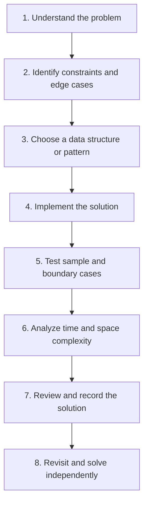

<div align="center">


# DSA-Leetcode

**A structured collection of LeetCode solutions for strengthening problem-solving skills and preparing for technical interviews.**

[](https://leetcode.com/)
[](https://github.com/Harsh-tech8/DSA-Leetcode)
[](https://github.com/arunbhardwaj/LeetHub-2.0)
[](https://github.com/Harsh-tech8/DSA-Leetcode)

[Explore Solutions](#-solution-library) · [Topics](#-topics-covered) · [Workflow](#-problem-solving-workflow) · [Run Locally](#-work-with-this-repository)

</div>

---

## 📌 About

This repository documents my ongoing practice with **Data Structures and Algorithms (DSA)** through LeetCode. Each solved problem is kept in its own numbered folder, making solutions easier to find, review, and revisit.

The repository is synced using **LeetHub v2**. The goal is not simply to collect accepted submissions, but to develop a repeatable approach to breaking down problems, selecting suitable algorithms, handling edge cases, and understanding complexity.

### 🎯 Objectives

- Build strong fundamentals in data structures and algorithms.
- Recognize recurring problem-solving patterns.
- Improve code correctness, readability, and efficiency.
- Review previous solutions and learn from challenging problems.
- Maintain a consistent record of technical interview preparation.

---

## 📊 Repository at a Glance

| Item | Details |
|---|---|
| Platform | LeetCode |
| Repository format | One numbered folder per problem |
| Organization | LeetCode problem IDs and titles |
| Sync workflow | LeetHub v2 |
| Main purpose | DSA practice and interview preparation |
| Progress tracking | Committed solutions and repository history |

> **Note:** The number of solutions changes as new problems are solved. This README avoids hard-coded totals so the information does not become misleading or outdated.

---

## 🧭 Topics Covered

The existing repository's LeetCode topic index includes problems across the following areas. Topics can overlap because one problem may use several techniques.

| Core area | Topics and patterns |
|---|---|
| **Arrays & Strings** | Arrays, matrices, strings, prefix sums, counting, simulation |
| **Searching & Sorting** | Binary search, sorting, search in rotated arrays, order-based techniques |
| **Pointers & Windows** | Two pointers, sliding-window-related problems |
| **Hashing** | Hash tables, frequency counting |
| **Linked Lists** | List traversal, reversal, cycle detection, doubly linked lists |
| **Stacks & Queues** | Valid parentheses, monotonic-stack patterns, stack-based traversal |
| **Trees & BSTs** | Tree traversal, validation, construction, ancestors, iterators |
| **Graphs & Traversal** | Depth-first search (DFS), breadth-first search (BFS), matrix traversal, course scheduling |
| **Recursion & Backtracking** | Permutations, subsets, combination sum, Sudoku, N-Queens |
| **Dynamic Programming** | Fibonacci, maximum subarray, memoization, optimization patterns |
| **Greedy & Math** | Greedy reasoning, number theory, prime-number problems |
| **Bit Manipulation** | Bit-based operations and subset-related techniques |
| **Design Problems** | Data-structure design, including LRU cache and minimum stack |

### 🔎 Explore representative solutions

These links point to problem folders that already exist in this repository:

- [0001 — Two Sum](https://github.com/Harsh-tech8/DSA-Leetcode/tree/main/0001-two-sum)
- [0011 — Container With Most Water](https://github.com/Harsh-tech8/DSA-Leetcode/tree/main/0011-container-with-most-water)
- [0020 — Valid Parentheses](https://github.com/Harsh-tech8/DSA-Leetcode/tree/main/0020-valid-parentheses)
- [0021 — Merge Two Sorted Lists](https://github.com/Harsh-tech8/DSA-Leetcode/tree/main/0021-merge-two-sorted-lists)
- [0053 — Maximum Subarray](https://github.com/Harsh-tech8/DSA-Leetcode/tree/main/0053-maximum-subarray)
- [0146 — LRU Cache](https://github.com/Harsh-tech8/DSA-Leetcode/tree/main/0146-lru-cache)
- [0200 — Number of Islands](https://github.com/Harsh-tech8/DSA-Leetcode/tree/main/0200-number-of-islands)
- [0207 — Course Schedule](https://github.com/Harsh-tech8/DSA-Leetcode/tree/main/0207-course-schedule)
- [0704 — Binary Search](https://github.com/Harsh-tech8/DSA-Leetcode/tree/main/0704-binary-search)
- [0994 — Rotting Oranges](https://github.com/Harsh-tech8/DSA-Leetcode/tree/main/0994-rotting-oranges)

For the full topic-based list, use the **LeetCode Topics** section further down this README, generated from the repository's synced index.

---

## 🗂️ Repository Structure

Problem folders use the LeetCode ID and title, for example:

```text
DSA-Leetcode/
├── 0001-two-sum/
├── 0007-reverse-integer/
├── 0009-palindrome-number/
├── 0011-container-with-most-water/
├── 0015-3sum/
├── 0020-valid-parentheses/
├── 0021-merge-two-sorted-lists/
├── ...
├── README.md
└── stats.json
```

**How to read this structure**

- **Problem ID** — preserves the original LeetCode problem number.
- **Problem title** — makes folders easy to recognize and search.
- **Problem folder** — contains the files synced for that problem.
- **`README.md`** — explains how to navigate and use the collection.
- **`stats.json`** — repository metadata maintained by the sync workflow.

The tree above is an illustrative excerpt, not a complete file listing. Existing solution files and their language are intentionally left unchanged.

---

## 🔁 Problem-Solving Workflow



### ✅ Personal review checklist

Before marking a problem as learned, I aim to check:

- [ ] I can explain the approach in plain language.
- [ ] I understand why the algorithm works.
- [ ] I have considered edge cases and constraints.
- [ ] I can estimate time and auxiliary space complexity.
- [ ] I can implement the solution again without copying it.
- [ ] I know which pattern could help solve similar problems.

---

## 💻 Work With This Repository

### 1. Clone the repository

```bash
git clone https://github.com/Harsh-tech8/DSA-Leetcode.git
cd DSA-Leetcode
```

### 2. Browse a solution

Open a numbered problem folder, read the existing solution, and trace it with a small example. The language and file names depend on the synced problem files.

### 3. Keep your local copy up to date

```bash
git pull origin main
```

### 4. Submit improvements

If you make local changes and want to save them to your own repository:

```bash
git add .
git commit -m "Update DSA practice"
git push origin main
```

Only run the push commands after checking that your changes are ready and that your Git remote points to the correct repository.

---

## 🧰 Tools & Technologies

- **LeetCode** — problem-solving practice.
- **Git and GitHub** — version control and source-code hosting.
- **LeetHub v2** — syncing supported submissions to GitHub.
- **Markdown** — documentation and navigation.

---

## 🚀 Ongoing Goals

- Practise consistently across core DSA topics.
- Improve the clarity and efficiency of solutions.
- Revisit difficult problems and compare approaches.
- Strengthen complexity analysis and edge-case handling.
- Use this repository as evidence of consistent technical learning.

---

## 🤝 Connect

<div align="center">

**Harsh-tech8 · DSA Practice & Continuous Learning**

[](https://github.com/Harsh-tech8)
[](https://github.com/Harsh-tech8/DSA-Leetcode)

<sub>Understand the pattern. Solve the problem. Learn from the process.</sub>


</div>
